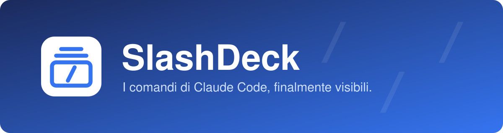

<p align="center">
  
</p>

<p align="center">
  <a href="../../releases/latest"></a>
  
  
  
  
</p>

<p align="center">
  <a href="#download"><b>⬇️ Download</b></a> ·
  <a href="#cosa-fa"><b>✨ Cosa fa</b></a> ·
  <a href="#come-si-usa"><b>🚀 Come si usa</b></a> ·
  <a href="#come-funziona"><b>🧩 Come funziona</b></a>
</p>

---

**Rendi visibili i comandi di Claude Code che nessuno documenta.**

Digitando `/` Claude Code mostra già i comandi con una descrizione. Il problema vero è un altro: un collega aggiunge una skill o un comando di progetto e nessuno lo viene a sapere, e chi cerca "come faccio X?" non sa quale comando usare.

SlashDeck scopre tutti i comandi disponibili nel tuo workspace, mette in evidenza quelli di progetto, dei plugin e di team, e ti permette di cercarli **per intenzione** ("voglio fare X") prima ancora di sfogliarli.

## Cosa fa

- **Scopre i comandi** chiedendoli alla CLI di Claude Code installata (senza inviare alcun prompt) e li collega ai file sorgente: comandi custom, skill, plugin.
- **Mette in evidenza** ciò che è del progetto e del team: da dove viene ogni comando, quali sono nuovi (badge "nuovo"), cosa dice il team su quando usarli.
- **Cerca per intenzione** su nomi e descrizioni.
- **Preferiti e modifiche personali**: fissa i comandi che usi di più e correggi le descrizioni a modo tuo.
- **Override di team**: il file `.claude/slashdeck.json`, versionato nella repo, contiene le indicazioni condivise ("usalo prima di ogni rilascio su dev01").
- **Trasparenza**: ogni testo mostra la sua origine (Claude Code, team, modificato da te).

## Privacy

- Il contenuto di comandi, skill e plugin **non lascia mai la tua macchina**: niente motori di ricerca, niente servizi esterni.
- Non serve nessuna chiave API.
- I dati dell'account restituiti dalla CLI non vengono mai salvati né scritti nei log.

## Download

| Editor | Pacchetto | Versione |
| --- | --- | --- |
|  **VS Code** (1.93 o successivo) | [⬇️ slashdeck-0.1.1.vsix](../../releases/latest/download/slashdeck-0.1.1.vsix) | 0.1.1 |
|  **WebStorm** (2026.1 – 2026.3) | [⬇️ slashdeck-jetbrains-0.1.0.zip](../../releases/latest/download/slashdeck-jetbrains-0.1.0.zip) | 0.1.0 |

Tutte le versioni sono nella pagina [Releases](../../releases).

### Installazione in VS Code

```bash
code --install-extension slashdeck-0.1.1.vsix
```

oppure: pannello **Estensioni** → menù `…` → **Installa da VSIX…** e scegli il file scaricato.

### Installazione in WebStorm

**Settings | Plugins** → icona dell'ingranaggio → **Install Plugin from Disk…** e scegli lo zip scaricato (senza decomprimerlo).

### Requisiti

- [Claude Code](https://claude.com/claude-code) installato e raggiungibile (`claude` nel PATH, oppure percorso indicato nelle impostazioni).
- Per il plugin WebStorm: Node 20 o successivo.
- Senza Claude Code SlashDeck funziona comunque in modalità di riserva, leggendo solo i file `.claude/`, e lo segnala.

## Come si usa

**VS Code**

- `SlashDeck: Cerca comando` dalla Command Palette: ricerca su nomi e descrizioni.
- Vista **SlashDeck** nella Activity Bar: Preferiti, Progetto, Plugin, Personali e comandi integrati, con tooltip che mostrano descrizione, argomenti, origine e file sorgente.
- Clic su un comando → **Copia** (azione primaria), **Esegui** (solo se è rilevato un terminale in cui gira `claude`), Apri file sorgente, Fissa, Modifica descrizione.
- `SlashDeck: Aggiorna elenco` per riscansionare subito.

**WebStorm**

- ToolWindow **SlashDeck** con la stessa organizzazione per gruppi, filtro di testo e le stesse azioni.
- L'elenco si aggiorna da solo quando cambiano i file di progetto in `.claude/`; il pulsante "Aggiorna" è sempre immediato.

**Dentro Claude Code (skill di aiuto)**

Una skill che risponde a "quali comandi esistono?" e "voglio fare X, quale comando uso?" a partire dallo stesso catalogo. Non richiede codice IDE: funziona in terminale, VS Code e JetBrains. Istruzioni in [packages/skill/README.md](packages/skill/README.md).

## Come funziona

Monorepo con un **core condiviso** e front-end sottili. Tutta la logica (scoperta, cache, stato) sta nel core; skill e plugin IDE non la duplicano.

```
packages/
├── core/        Libreria + CLI `slashdeck` (Node + TypeScript)
├── skill/       Skill di aiuto per Claude Code
├── vscode/      Estensione VS Code
└── jetbrains/   Plugin IntelliJ Platform (Kotlin) per WebStorm
```

Il catalogo viene dalla CLI di Claude Code; la scansione dei file `.claude/` attribuisce a ogni comando il tipo e il file sorgente. Il risultato viene messo in cache per workspace, così l'albero compare subito all'avvio dell'IDE, e sopra si applicano l'override di team e le modifiche dell'utente.

Per i dettagli di architettura e modello dati vedi [CLAUDE.md](CLAUDE.md).

## Sviluppo

Servono Node LTS e pnpm; per il plugin JetBrains anche un JDK 21.

```bash
pnpm install
pnpm -r build
pnpm -r test
pnpm --filter slashdeck run package        # crea packages/vscode/slashdeck-<versione>.vsix

# Plugin JetBrains (JAVA_HOME su un JDK 21, dopo `pnpm -r build`)
cd packages/jetbrains && ./gradlew test buildPlugin verifyPlugin
```

## Stato del progetto

Nome e editore sono provvisori. L'estensione VS Code e il plugin WebStorm sono stati provati con test automatici e con il Claude Code reale, ma l'interfaccia non è ancora stata collaudata a lungo in un IDE vero: segnala i problemi nelle [Issues](../../issues).
